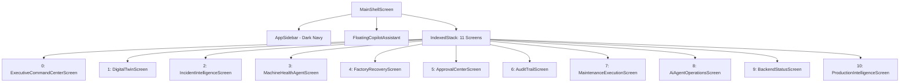

# Texora AI — Complete Existing Application Audit

**Date of Audit**: October 14, 2026  
**Auditor**: Principal Flutter Web Architect & Senior Django REST Framework Engineer  
**Workspace Root**: `C:\Users\projects\texora-ai`  
**Git Branch**: `main`  

---

## 1. Executive Summary & Purpose

This audit provides a granular, evidence-based technical baseline of the entire **Texora AI** system before executing any UI redesign. Every component—from database models and REST endpoints to Flutter screens, state management controllers, and automated test fixtures—was inspected directly from source code.

### Primary Audit Conclusions
1. **Solid Industrial Architecture**: The backend possesses an enterprise-grade Django REST Framework architecture covering digital twins, machine telemetry time-series, incident management, 6 AI agent specializations, multi-stage recovery orchestration, maintenance lifecycle governance, capacity routing, and grounded AI copilot conversations.
2. **Backend Seed Data and Endpoints Already Exist for Most Reference Needs**: Django apps for machines, production, maintenance, quality, inventory, energy, audit logs, and copilot already exist with active models and endpoints. Some screens (e.g. Quality, Energy, Inventory) have complete database models and REST ViewSets in Django, but currently lack dedicated visual front-end screens in Flutter's `main_shell_screen.dart`.
3. **Existing UI Is Dark-Navy Themed with Industrial Monospace Elements**: The existing Flutter UI (`frontend/lib/presentation/`) was designed as a dark industrial command console (`#0A0F1D` background and `#0F172A` cards). In contrast, the 13-screen reference design uses a hybrid design language: an enterprise dark navy sidebar (`#0B132B`) paired with a clean, high-contrast, modern pale blue-gray workspace (`#F8FAFC`), crisp white cards (`#FFFFFF`), refined typography, and modern data tables.
4. **Zero Production Mock Services**: All production services in `frontend/lib/data/services/` ([ApiService](file:///c:/Users/projects/texora-ai/frontend/lib/data/services/api_service.dart), [ProductionApiService](file:///c:/Users/projects/texora-ai/frontend/lib/data/services/production_api_service.dart), [CopilotService](file:///c:/Users/projects/texora-ai/frontend/lib/data/services/copilot_service.dart)) dispatch live HTTP requests to Django (`${AppConfig.baseUrl}/api/v1/...`). Mock and fake services are strictly confined to `frontend/test/` automated widget test fixtures.
5. **Advanced Capabilities That Must Be Preserved**:
   - Executive Command Center & multi-agent expo trigger
   - Factory Digital Twin with 3D coordinate layout and dependency trees
   - AI Incident Intelligence with LLM chain-of-thought traces
   - Machine Health AI Specialist with telemetry anomaly flags
   - Factory Recovery Engine with multi-strategy What-If simulation
   - Manager Approval Center with human-in-the-loop governance
   - Immutable Audit Trail
   - Maintenance Execution Center with technician verification gates
   - Production Intelligence (Phase 15) multi-department capacity routing
   - Factory AI Copilot (grounded conversation engine)
   - Dual-provider Groq & Gemini multi-agent reasoning with deterministic fallback

---

## 2. Granular Inventory of Flutter Screens & Navigation

The current application shell is orchestrated by [main_shell_screen.dart](file:///c:/Users/projects/texora-ai/frontend/lib/presentation/screens/main_shell_screen.dart) and [app_sidebar.dart](file:///c:/Users/projects/texora-ai/frontend/lib/presentation/widgets/app_sidebar.dart). It uses an `IndexedStack` indexing 11 primary operational screens, plus a global floating and full-screen AI Copilot assistant.

### Detailed Screen-by-Screen Inventory

| Nav Index | Screen Class | File Location | Functional Description | Current Data Source |
|---|---|---|---|---|
| **0** | `ExecutiveCommandCenterScreen` | [executive_command_center_screen.dart](file:///c:/Users/projects/texora-ai/frontend/lib/presentation/screens/executive_command_center_screen.dart) | High-level executive dashboard showing operational health, active alerts, live telemetry aggregations, department flow view, and the Autonomous Expo Demo launcher. | Live Django `/api/v1/digital-twin/snapshot/latest/`, `/api/v1/alerts/`, `/api/v1/work-orders/`, `/api/v1/autonomous/expo-demo/`. |
| **1** | `DigitalTwinScreen` | [digital_twin_screen.dart](file:///c:/Users/projects/texora-ai/frontend/lib/presentation/screens/digital_twin_screen.dart) | Real-time interactive 3D/2D digital twin layout of all textile machines mapped across Spinning, Weaving, Knitting, Dyeing, and Finishing departments. | Live Django `/api/v1/digital-twin/snapshot/`, `/api/v1/digital-twin/departments/`. |
| **2** | `IncidentIntelligenceScreen` | [incident_intelligence_screen.dart](file:///c:/Users/projects/texora-ai/frontend/lib/presentation/screens/incident_intelligence_screen.dart) | Incident triage workspace displaying active factory anomalies, sensor telemetry violations, AI diagnosis chain-of-thought, and routing to recovery. | Live Django `/api/v1/incidents/`, `/api/v1/autonomous/incident-workflow/{id}/`. |
| **3** | `MachineHealthAgentScreen` | [machine_health_agent_screen.dart](file:///c:/Users/projects/texora-ai/frontend/lib/presentation/screens/machine_health_agent_screen.dart) | Specialist machine health monitoring, sensor vibration/temperature time-series plots, health degradation scoring, and anomaly alerts. | Live Django `/api/v1/machines/`, `/api/v1/machines/{id}/telemetry/`. |
| **4** | `FactoryRecoveryScreen` | [factory_recovery_screen.dart](file:///c:/Users/projects/texora-ai/frontend/lib/presentation/screens/factory_recovery_screen.dart) | Multi-agent recovery orchestration workspace, multi-step action plans, dependency tracking, and strategy comparison (Strategy A vs B vs C). | Live Django `/api/v1/recovery-cases/`, `/api/v1/autonomous/runs/`. |
| **5** | `ApprovalCenterScreen` | [approval_center_screen.dart](file:///c:/Users/projects/texora-ai/frontend/lib/presentation/screens/approval_center_screen.dart) | Human-in-the-loop managerial governance gate for high-risk actions (emergency stops, order rerouting, parts requisition). | Live Django `/api/v1/approvals/`, `/api/v1/approvals/{id}/approve/`, `/api/v1/approvals/{id}/reject/`. |
| **6** | `AuditTrailScreen` | [audit_trail_screen.dart](file:///c:/Users/projects/texora-ai/frontend/lib/presentation/screens/audit_trail_screen.dart) | Cryptographically verifiable immutable compliance ledger tracking all autonomous decisions, tool invocations, and manual operator overrides. | Live Django `/api/v1/audit-logs/`. |
| **7** | `MaintenanceExecutionScreen` | [maintenance_execution_screen.dart](file:///c:/Users/projects/texora-ai/frontend/lib/presentation/screens/maintenance_execution_screen.dart) | Digital work order execution console for floor technicians: guided inspection checklist, physical fault confirmation, parts consumption, and recovery verification. | Live Django `/api/v1/maintenance/tickets/`, `/api/v1/maintenance/tickets/{id}/execution-detail/`. |
| **8** | `AiAgentOperationsScreen` | [ai_agent_operations_screen.dart](file:///c:/Users/projects/texora-ai/frontend/lib/presentation/screens/ai_agent_operations_screen.dart) | Fleet status of all AI agents (Machine Health, Maintenance, Production Impact, Inventory, Quality, Energy), LLM provider metrics (Groq vs Gemini), latency, and execution logs. | Live Django `/api/v1/ai-agents/operations-overview/`, `/api/v1/executions/`. |
| **9** | `BackendStatusScreen` | [backend_status_screen.dart](file:///c:/Users/projects/texora-ai/frontend/lib/presentation/screens/backend_status_screen.dart) | System diagnostics screen monitoring Django API health, database readiness, Redis/Celery workers, latency measurements, and simulated endpoints. | Live Django `/api/v1/health/`, `/api/v1/health/readiness/`, `/api/v1/health/workers/`. |
| **10** | `ProductionIntelligenceScreen` | [production_intelligence_screen.dart](file:///c:/Users/projects/texora-ai/frontend/lib/presentation/screens/production_intelligence_screen.dart) | Phase 15 multi-department capacity routing engine: department utilization cards, active bottlenecks, job orders table, delivery delay risks, and progression simulation. | Live Django `/api/v1/production/overview/`, `/api/v1/production/orders/`, `/api/v1/production/simulate-progression/`. |
| **Global** | `FactoryCopilotScreen` | [factory_copilot_screen.dart](file:///c:/Users/projects/texora-ai/frontend/lib/presentation/screens/factory_copilot_screen.dart) | Full-screen conversational AI assistant with citation grounding, contextual recommendations, and direct navigation links. | Live Django `/api/v1/copilot/sessions/`, `/api/v1/copilot/suggestions/`. |
| **Auxiliary** | `WhatIfSimulationScreen` | [what_if_simulation_screen.dart](file:///c:/Users/projects/texora-ai/frontend/lib/presentation/screens/what_if_simulation_screen.dart) | Parametric what-if scenario builder for downtime prediction and financial loss estimation. | Live Django `/api/v1/digital-twin/what-if/scenarios/`, `/api/v1/digital-twin/what-if/simulate/`. |
| **Auxiliary** | `AnomalyIncidentsScreen` | [anomaly_incidents_screen.dart](file:///c:/Users/projects/texora-ai/frontend/lib/presentation/screens/anomaly_incidents_screen.dart) | Filterable anomaly incident list with severity badges. | Live Django `/api/v1/incidents/`. |
| **Auxiliary** | `SimulationScreen` | [simulation_screen.dart](file:///c:/Users/projects/texora-ai/frontend/lib/presentation/screens/simulation_screen.dart) | Simulation control console with tick runner, speed multipliers, and manual anomaly injector. | Live Django `/api/v1/simulation/control/`, `/api/v1/simulation/inject-scenario/`. |

---

## 3. Granular Inventory of Frontend Widgets & Design Elements

All existing widgets are located in [frontend/lib/presentation/widgets/](file:///c:/Users/projects/texora-ai/frontend/lib/presentation/widgets/):

1. **`AppSidebar`** ([app_sidebar.dart](file:///c:/Users/projects/texora-ai/frontend/lib/presentation/widgets/app_sidebar.dart)):
   - Renders a 260px (or 72px collapsed) dark navy sidebar (`#0A0F1D`).
   - Grouped into `OVERVIEW`, `OPERATIONS`, and `GOVERNANCE & SYSTEM`.
   - Uses small pill badges (`LIVE`, `TWIN`, `FLEET`, `OPS`, `AI`, `ORCH`, `EXEC`, `PROD`, `GATE`, `AUDIT`, `STATUS`).
   - Differences from Reference: The reference sidebar has 9 clean top-level items (`Dashboard`, `AI Agents`, `Machines`, `Production`, `Quality`, `Maintenance`, `Inventory`, `Energy`, `Reports`) with royal blue active highlights (`#1D4ED8` or `#2563EB`) and no uppercase category clutter.

2. **`DepartmentStatusCard`** ([department_status_card.dart](file:///c:/Users/projects/texora-ai/frontend/lib/presentation/widgets/department_status_card.dart)):
   - Displays department name, capacity, active machines, utilization percentage bar, and bottleneck status.
   - Used heavily in `ProductionIntelligenceScreen`.

3. **`FactoryFlowView`** ([factory_flow_view.dart](file:///c:/Users/projects/texora-ai/frontend/lib/presentation/widgets/factory_flow_view.dart)):
   - Interactive schematic diagram showing material flow across 5 departments: Spinning -> Weaving -> Knitting -> Dyeing -> Finishing.
   - Provides live visual health statuses and click-to-filter capability.

4. **`FloatingCopilotAssistant`** ([floating_copilot_assistant.dart](file:///c:/Users/projects/texora-ai/frontend/lib/presentation/widgets/floating_copilot_assistant.dart)):
   - Floating circular action button in bottom-right corner expandable into an overlay chat modal or full-screen session.
   - Preserves state across all screens.

5. **`IndustrialWidgets`** ([industrial_widgets.dart](file:///c:/Users/projects/texora-ai/frontend/lib/presentation/widgets/industrial_widgets.dart)):
   - Reusable UI building blocks: `IndustrialCard`, `LiveBadge`, `AnomalyPill`, `DataValueMetric`, `MetricTrendSparkline`.

6. **`MetricCard`** ([metric_card.dart](file:///c:/Users/projects/texora-ai/frontend/lib/presentation/widgets/metric_card.dart)):
   - General-purpose metric card with title, large numeric value, trend indicator (percentage change vs yesterday), and optional subtitle.

7. **`StatusBadge`** ([status_badge.dart](file:///c:/Users/projects/texora-ai/frontend/lib/presentation/widgets/status_badge.dart)):
   - Renders color-coded status capsules (`OPERATIONAL`, `CRITICAL`, `WARNING`, `MAINTENANCE`, `IN_PROGRESS`, etc.).

8. **`AgentExecutionDetailDialog`** ([agent_execution_detail_dialog.dart](file:///c:/Users/projects/texora-ai/frontend/lib/presentation/widgets/agent_execution_detail_dialog.dart)):
   - Modal inspection dialog revealing full LLM prompt, context payload, system instructions, token usage, latency, and tool invocation response.

---

## 4. Granular Inventory of Backend Django Applications

The backend consists of 15 Django apps under [backend/apps/](file:///c:/Users/projects/texora-ai/backend/apps/), connected via [backend/config/urls.py](file:///c:/Users/projects/texora-ai/backend/config/urls.py):

| Django App | Primary Models | Primary REST Endpoints | Capabilities & Role |
|---|---|---|---|
| **`machines`** | `Machine`, `MachineType`, `MachineTelemetry`, `MachineOperatingLimits`, `MachineStateHistory` | `/api/v1/machines/` `/api/v1/machines/{id}/telemetry/` `/api/v1/telemetry/` | Physical machine registry, sensor limit definitions, and real-time sensor timeseries storage. |
| **`production`** | `ProductionOrder`, `ProductionBatch`, `MachineProductionAssignment`, `ProductionProgress`, `ProductionCapacityProfile`, `ProductionBottleneck`, `ProductionImpactAssessment` | `/api/v1/production/overview/` `/api/v1/production/orders/` `/api/v1/production/department-capacity/` `/api/v1/production/bottlenecks/` `/api/v1/production/simulate-progression/` | Phase 15 Production Intelligence: capacity routing, delay risk estimation, bottleneck detection, and progression simulation. |
| **`maintenance`** | `MaintenanceTicket`, `WorkOrderTransition`, `WorkOrderAttachment`, `MaintenanceActivity`, `MaintenanceHistory` | `/api/v1/maintenance/tickets/` `/api/v1/maintenance/tickets/{id}/execution-detail/` `/api/v1/maintenance/tickets/{id}/transition/` `/api/v1/maintenance/tickets/{id}/simulate-technician-flow/` | Work order lifecycle management, technician checklists, part replacement, and post-repair telemetry verification. |
| **`quality`** | `QualityInspection`, `QualityDefect` | `/api/v1/inspections/` `/api/v1/defects/` | Batch quality records, defect taxonomy (Yarn Unevenness, Barre Effect, Shade Variation), severity, and defect counters. |
| **`inventory`** | `InventoryItem`, `InventoryTransaction`, `SparePartRequirement` | `/api/v1/inventory/items/` `/api/v1/inventory/items/low_stock/` `/api/v1/inventory/transactions/` `/api/v1/inventory/spare-requirements/` | Spare parts warehouse management, safety stock thresholds, reorder points, and automated stock reservation. |
| **`energy`** | `EnergyReading` | `/api/v1/energy/readings/` | Sub-metered electrical load monitoring: kW active power, kWh energy, power factor, voltage, and peak hour detection. |
| **`ai_agents`** | `AgentDefinition`, `AgentExecution`, `AgentDecision`, `AgentAction`, `RecoveryCase`, `RecoveryPlanStep`, `AutonomousWorkflowRun` | `/api/v1/agents/` `/api/v1/executions/` `/api/v1/recovery-cases/` `/api/v1/autonomous/expo-demo/` `/api/v1/ai-agents/operations-overview/` | Autonomous orchestrator, 6 specialist agent definitions, dual-provider Groq & Gemini client, multi-agent recovery coordination. |
| **`digital_twin`** | `FactorySnapshot`, `WhatIfScenario`, `WhatIfResult` | `/api/v1/digital-twin/snapshot/` `/api/v1/digital-twin/departments/` `/api/v1/digital-twin/what-if/scenarios/` `/api/v1/digital-twin/what-if/simulate/` | Real-time digital twin state snapshot, factory dependency graph, and parametric what-if simulation engine. |
| **`incidents`** | `FactoryIncident`, `IncidentTelemetryTrace` | `/api/v1/incidents/` `/api/v1/incidents/{id}/resolve/` | Factory anomaly records, root-cause correlation, and incident resolution tracking. |
| **`approvals`** | `ApprovalRequest` | `/api/v1/approvals/` `/api/v1/approvals/{id}/approve/` `/api/v1/approvals/{id}/reject/` | Managerial approval requests for automated AI actions. |
| **`audit_logs`** | `AuditLog` | `/api/v1/audit-logs/` | Cryptographic/immutable audit ledger of all system events. |
| **`copilot`** | `CopilotSession`, `CopilotMessage` | `/api/v1/copilot/sessions/` `/api/v1/copilot/suggestions/` | Grounded factory copilot reasoning engine with context citations. |
| **`simulation`** | `SimulationScenario`, `SimulationEventLog` | `/api/v1/simulation/control/` `/api/v1/simulation/inject-scenario/` `/api/v1/simulation/summary/` | Simulated factory tick generation, anomaly injections, and deterministic test scenario runners. |
| **`factories`** | `Factory`, `Department`, `ProductionLine` | `/api/v1/factories/` `/api/v1/departments/` `/api/v1/lines/` | Factory physical hierarchy and department definitions. |
| **`core`** | N/A (utility services) | `/api/v1/health/` `/api/v1/health/readiness/` `/api/v1/health/workers/` | System health checks, daemon heartbeats, and database readiness probes. |

---

## 5. Automated Test Coverage Baseline

The existing test suite was run and completely validated:
- **Django Checks**: `python manage.py check` -> `System check identified no issues (0 silenced)`
- **Backend Pytest**: `pytest backend/tests` -> **152 passed** in 18.44 seconds
- **Frontend Flutter Analyze**: `flutter analyze` -> `No issues found!`
- **Frontend Flutter Test**: `flutter test` -> **95 passed, 0 failed** in 32 seconds

### Key Test Fixtures & Contracts
- [production_intelligence_screen_test.dart](file:///c:/Users/projects/texora-ai/frontend/test/production_intelligence_screen_test.dart): Validates `FakeProductionApiService` in widget tests, requiring strings `'PHASE 15'`, `'Production Intelligence'`, and department card widgets.
- [executive_command_center_screen_test.dart](file:///c:/Users/projects/texora-ai/frontend/test/executive_command_center_screen_test.dart): Validates `'AUTONOMOUS FACTORY INTELLIGENCE'`, `'System Ready'`, and `'SIMULATED FACTORY TELEMETRY'`.
- [data_contract_and_simulation_integration_test.dart](file:///c:/Users/projects/texora-ai/frontend/test/data_contract_and_simulation_integration_test.dart): Validates end-to-end data contracts for `ProductionOverviewModel`, `ProductionOrderModel`, simulation actions (`advance`, `breakdown`, `recover`), Copilot schema, and technician flow.

**Rule**: All existing test assertions must be preserved during and after redesign.
