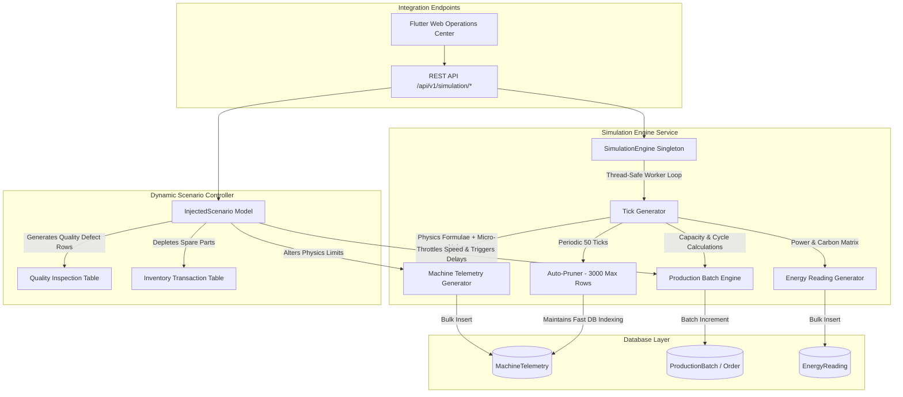

# Texora AI — Autonomous Factory Simulation Engine Guide

## 1. Overview & Architecture

The **Texora AI Simulation Engine** (`apps.simulation`) is a backend-driven, continuous industrial IoT simulation system designed to generate physically realistic machine telemetry, production output, quality inspections, energy consumption, and inventory changes for **25 physical textile machines** across **5 manufacturing departments** at the demo mill (*Texora Smart Textile Mill — Coimbatore #1*, `FAC-CBE-01`).



---

## 2. Seeded Textile Factory Assets (`FAC-CBE-01`)

The factory simulation is initialized idempotently via `python manage.py seed_factory`. It models standard textile equipment operating limits:

| Department | Code | Physical Machines Seeded | Baseline Temp | Baseline Vibration | Baseline Speed |
| :--- | :--- | :--- | :--- | :--- | :--- |
| **Spinning** | `SPN` | 7 Machines (Trützschler Carding, Rieter Draw Frame, Rieter Ring Frames G38 #1-#3, Murata Auto-Coners #1-#2) | 70.5 °C | 2.8 mm/s | 18,000–19,500 Spindle RPM |
| **Weaving** | `WEV` | 6 Machines (Karl Mayer Warper, Picanol OmniPlus-i #1-#2, Toyota JAT810 #3-#4, Itema R9500-2 Rapier) | 62.0 °C | 3.2 mm/s | 680–1,100 Loom RPM |
| **Knitting** | `KNT` | 4 Machines (Mayer & Cie Circular Knitters #1-#2, Terrot Interlock, Shima Seiki Flat Knitter) | 48.5 °C | 2.1 mm/s | 26–120 RPM |
| **Dyeing** | `DYE` | 4 Machines (Fongs Soft Flow HTHP Vessels #1-#2, Thies iMaster Low-Liquor, Fongs Yarn Package) | 128.0–132.0 °C | 2.4 mm/s | 280–350 RPM |
| **Finishing** | `FIN` | 4 Machines (Monforts 8-Chamber Stenter Frame, Ferraro Compactor, Daroitex Inspection Tables #1-#2) | 182.0–190.0 °C | 2.6 mm/s | 45–80 m/min |

---

## 3. Controlling the Simulation

### A. Via Management Command (CLI)

1. **Discrete Synchronous Ticks (Testing / Step Mode):**
   ```powershell
   python backend\manage.py run_simulation --ticks 10 --interval 1.0 --speed 2.0
   ```

2. **Continuous Background Daemon Mode:**
   ```powershell
   python backend\manage.py run_simulation --interval 3.0 --speed 1.0
   ```

3. **Start with Injected Anomaly:**
   ```powershell
   python backend\manage.py run_simulation --inject-scenario WEAVING_VIBRATION --target-machine WEV-AJ-02
   ```

### B. Via REST API

| Method | Endpoint | Description | Sample Payload |
| :--- | :--- | :--- | :--- |
| `GET` | `/api/v1/simulation/status/` | Returns engine state, ticks, and active scenarios | — |
| `POST` | `/api/v1/simulation/start/` | Starts worker loop | `{"speed_multiplier": 1.0, "tick_interval_seconds": 3.0}` |
| `POST` | `/api/v1/simulation/pause/` | Pauses simulation execution | `{}` |
| `POST` | `/api/v1/simulation/resume/` | Resumes paused engine | `{}` |
| `POST` | `/api/v1/simulation/stop/` | Stops simulation worker | `{}` |
| `POST` | `/api/v1/simulation/tick/` | Executes 1 discrete synchronous simulation tick | `{}` |
| `POST` | `/api/v1/simulation/inject-scenario/` | Injects operational anomaly | `{"scenario_type": "WEAVING_VIBRATION", "target_machine_code": "WEV-AJ-02"}` |
| `POST` | `/api/v1/simulation/clear-scenarios/` | Clears all active scenarios & restores status | `{}` or `{"scenario_id": 1}` |
| `GET` | `/api/v1/simulation/summary/` | Full operational summary for UI streaming | — |

---

## 4. Supported Scenario Injections

1. **`WEAVING_VIBRATION`**: Injects excessive bearing vibration (5.9–7.4 mm/s vs warning limit 4.0 mm/s) on weaving looms (e.g. `WEV-AJ-02`).
2. **`SPINNING_OVERHEAT`**: Injects high thermal runaway (86.5–94.0 °C vs warning limit 74.0 °C) on ring spinning frames (e.g. `SPN-RS-03`).
3. **`PRODUCTION_SLOWDOWN`**: Injects draft roller slippage bottleneck, reducing speed/throughput by 55% and creating a `ProductionDelay` record.
4. **`QUALITY_DEFECT_SPIKE`**: Injects optical inspection failures with `BARRE_EFFECT` or `YARN_UNEVENNESS` defect records into active production batches.
5. **`SPARE_PART_SHORTAGE`**: Depletes critical maintenance inventory items below threshold, creating negative `InventoryTransaction` rows.
6. **`ENERGY_SURGE`**: Injects a 240% power draw spike (kW) and triggers peak-demand warning conditions.

---

## 5. SQLite vs PostgreSQL Concurrency Considerations

- **Multi-Engine Compatibility:** The database architecture maintains 100% ANSI SQL and PostgreSQL data type compatibility while using SQLite for local development (`DB_ENGINE=sqlite`).
- **Thread Connection Hygiene:** The simulation worker invokes `close_old_connections()` at each tick iteration to avoid SQLite thread-locking and database lock errors.
- **Auto-Pruning:** Every 50 ticks, historical `MachineTelemetry` and `EnergyReading` tables are pruned to maintain the most recent 2,500 records, ensuring local SQLite disk operations remain under 5ms per transaction.

---

## 6. Handover to Phase 4 (Autonomous Anomaly Detection Engine)

Phase 4 will consume the live simulation stream produced by this engine:
- **Baseline Physics Profiles:** Machine operating limits table (`MachineOperatingLimits`) provides ground-truth warning/critical thresholds.
- **Statistical Z-Score & Moving Averages:** Anomaly detector will compute rolling means and standard deviations over the telemetry window.
- **Multi-Factor Correlation:** Incidents (`apps.incidents.Incident`) will automatically be created when sustained physical anomalies correlate across temperature, vibration, power, and quality defect tables.
- **Audit Logging:** Anomaly triggers will produce audit log entries for agent investigation in Phase 5.
